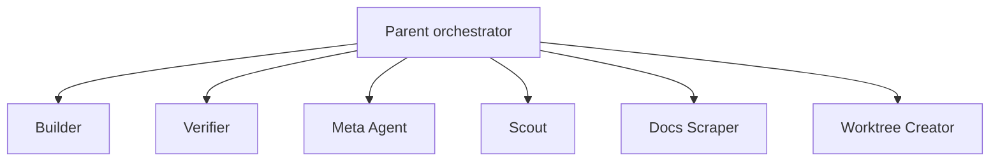

# Agent Teams

- Purpose: Explain how "agent teams" are composed in Cursor using a parent orchestrator, subagents, and optional worktrees.
- Audience: Operators and maintainers designing or extending multi-agent workflows.
- Prerequisites: Familiarity with Cursor subagents, slash commands, and the current agent files in `.cursor/agents/`.
- Status: complete
- Last updated: 2026-08-31
- Author: Cursor agent (GPT-5.4)

## Related Files

- [Agent instructions](../../AGENTS.md)
- [Components](components.md)
- [Orchestration workflow](orchestration-workflow.md)
- [Data flow](data-flow.md)
- [Configuration](configuration.md)
- [Migration backlog](../archive/migration-backlog.md) - historical Stage 0 reference only; use `ROADMAP.md` for active work
- [Artifacts index](artifacts-index.md)

## Team Model

This workflow treats Cursor's parent agent, subagents, and worktrees as the practical equivalent of Claude-style agent teams.

**Cursor and worktrees:** Isolation via Cursor **managed worktrees** (Agents Window), **`/worktree`**, **`/best-of-n`** (comparisons; no auto-merge), or manual `git worktree add` / `/mat-wt-create`. Do not assume every parallel Task subagent gets its own checkout. When a separate checkout exists, MAT bootstrap (`.cursor/hooks/bootstrap_worktree.sh`) defaults to `--metadata-only` (markers + collision-aware `runtime.env`); use `--install [--copy-env]` for deps. See [Worktree decision matrix](../archive/worktree-decision-matrix.md), [AGENTS.md](../../AGENTS.md), and [`specs/worktree-native-wrapper-v1.md`](specs/worktree-native-wrapper-v1.md).



ASCII fallback:

```text
Parent orchestrator
  |- Builder
  |- Verifier
  |- Meta Agent
  |- Scout
  |- Docs Scraper
  `- Worktree Creator
```

## Recommended Roles

Full role descriptions live in [AGENTS.md](../../AGENTS.md) (`## Agent Roles`). The table below captures each role's mode and purpose.

| Role | Default mode | Purpose |
|------|--------------|---------|
| Parent orchestrator | Read/write | Plan, delegate, retry, synthesize |
| Builder | Read/write | Implement and self-validate |
| Verifier | Read-mostly | Prove acceptance criteria with evidence |
| Meta Agent | Read/write | Create new agent definitions |
| Scout | Read-only | Investigate code or configuration problems |
| Docs Scraper | Read/write | Turn URLs into local markdown references |
| Worktree Creator | Read/write | Create isolated branches and environments |

## Team Composition Guidelines

- Start with `parent-orchestrator + builder + verifier`.
- Add scout when the work is investigation-heavy.
- Add docs scraper when external references need to be localized.
- Add worktree creator when you need **explicit** separate checkouts (branches) and MAT bootstrap/`runtime.env` setup — not because Cursor auto-provisions worktrees per agent.
- Use meta-agent only when you need a new specialist role, not as part of every run.

## How Meta Agent Creates New Team Members

The meta agent reads a user description and writes a new file in `.cursor/agents/`. It is best used for:

- Domain specialists like `db-migration-checker.md`
- Support roles like `release-note-writer.md`
- Investigation helpers like `api-contract-reviewer.md`

Example request:

```text
Use the meta-agent to create a read-only API contract reviewer
```

## Authoring New Subagent Definitions

Follow the house style already used in `.cursor/agents/`:

1. Start with a clear `# Agent Name` heading.
2. Define responsibilities and a step-by-step workflow.
3. State output files or report format explicitly.
4. Add stop conditions and capability notes.
5. Reference `.cursor/` paths, not `.claude/` paths.

Minimal template:

```markdown
# Example Agent

You are the **example** subagent. One purpose, clearly stated.

## Core Responsibilities
1. Do one thing well.

## Workflow
### Step 1 - Read input
### Step 2 - Perform work
### Step 3 - Report output
```

## Team Boundaries

- Parent owns sequencing.
- Builder owns changes.
- Verifier owns evidence-backed review.
- Hooks own lifecycle automation and observability.
- Worktrees own filesystem isolation.

## Parallel fan-out and file ownership

For **parent-mediated** parallel Task fan-out (`/mat-subagents-spawn`), MAT documents an explicit **File-ownership matrix** (path/glob classes → primary writer → concurrent readers → conflict resolution), a **concurrency budget**, and conflict / failed-worker / abandoned-work / duplicate-ownership handling in [`.cursor/commands/mat-subagents-spawn.md`](../../.cursor/commands/mat-subagents-spawn.md).

Key honesty rules (see that command for the full table):

- Integration is **parent-mediated** only — **no peer task-board** and no teammate-to-teammate messaging contract.
- Do **not** claim Cursor invents a worktree per Task by default; use explicit `/mat-wt-create`, Agents Window worktrees, or cloud isolation when write isolation is required.
- Disjoint write ownership is required before spawning; overlapping mutable paths → serialize under the parent.
- Canonical handoffs remain `docs/current-plan.md`, `build-result.md`, and parent-serialized `verify-result.md` (see [role write policy](role-write-policy.md)).

## Practical Example

Use the default team for a small feature:

```text
/mat-plan-team Add a small docs page and verify it
```

Expected team behavior:

- Parent writes the plan.
- Builder edits files and produces `build-result.md`.
- Verifier validates and produces `verify-result.md`.

## Acceptance Checklist

- [ ] The default roles and their responsibilities are clear.
- [ ] The file paths for team definitions are discoverable from this doc.
- [ ] A reviewer can use the Meta Agent guidance to add a new agent safely.
- [ ] The relationship between subagents and worktrees is explained without claiming unsupported Cursor features.
