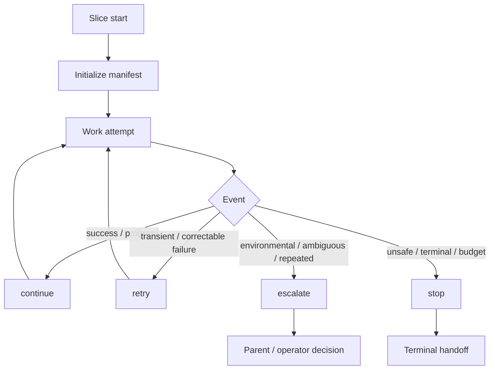

# MAT Loop Policy — Operator Reference

**Status:** shipped v0 (mission `mat-loop-policy-v0` complete, 2026-08-12)  
**Runtime:** `scripts/mat_loop_policy.py`  
**Schema:** `docs/schemas/loop-policy-schema.v1.json`  
**Planning spec:** `specs/mat-loop-policy-v0.md`
**Archived mission:** [`docs/archive/long-run-mat-loop-policy-v0-2026-08-12.md`](../archive/long-run-mat-loop-policy-v0-2026-08-12.md)

Native-first loop engineering for MAT orchestration. File handoffs (`docs/current-plan.md`, `build-result.md`, `verify-result.md`) remain **authoritative**; the loop policy engine is **advisory** unless operators opt in.

**Operator habits:** Day-to-day distinction between loop policy, Stop follow-up, run manifests, and PostToolUse scoped lint vs full verify — [`mat-operator-playbook.md`](../guides/mat-operator-playbook.md) § B9 (default-off loop policy; handoff gates stay canonical) and § A3b (hook lint layer; pair with § A3 profile honesty).

## Opt-in environment

| Variable | Default | Meaning |
|----------|---------|---------|
| `CURSOR_MAT_LOOP_POLICY` | `0` | Set to `1` to enable loop policy evaluation in orchestration paths. |
| `CURSOR_MAT_LOOP_PAUSE` | unset | When set, parent should pause loop progression until cleared (human gate). |
| `CURSOR_MAT_LOOP_EVENTS` | `0` | Set to `1` to append handoff events to `artifacts/loop/events.jsonl` on `docs/current-plan.md` or `build-result.md` writes (PostToolUse; fail-open). |
| `CURSOR_MAT_STOP_VALIDATOR_FOLLOWUP` | `0` | Set to `1` for Stop hook `followup_message` + exit 0 when orchestrated handoffs look incomplete (default off; exit 1 is fail-open in Cursor and is **not** used as strict enforcement). |

Hooks do **not** spawn subagents from loop policy output.

## Loop lifecycle



ASCII equivalent:

```
slice start → manifest → attempt → event → evaluate()
  continue  → next attempt
  retry     → fix + next attempt
  escalate  → parent review
  stop      → terminal state + handoff artifacts
```

## State model — authoritative hierarchy

1. **Gate-authoritative:** `build-result.md` / `verify-result.md` (`## Status`, acceptance criteria, lint rows) — MAO build→validate.
2. **Canonical plan:** `docs/current-plan.md` slice scope and acceptance criteria.
3. **Mission queue:** `docs/architecture/long-run-state.md` for multi-slice missions.
4. **Loop manifest:** `attempts`, `counters`, `failure_fingerprints`, `terminal` — loop iteration state (durable in slice 3+).
5. **Advisory:** `artifacts/mao/gate.json`, hook snapshots, loop `evaluate()` output.

Lower layers never override higher gate truth.

## Durable manifest layout (slice 3+)

Per-run state lives under **`artifacts/loop/<run-id>/`** (gitignored):

| Path | Purpose |
|------|---------|
| `artifacts/loop/<run-id>/manifest.json` | Canonical loop manifest for the run |
| `artifacts/loop/<run-id>/working-memory.md` | Optional compact summary (from template) |
| `artifacts/loop/manifest.json` | Legacy mirror for slice-2 consumers (`validate_artifacts`, parent docs) |
| `artifacts/loop/events.jsonl` | Opt-in append-only handoff events (`CURSOR_MAT_LOOP_EVENTS=1`) |

CLI (`scripts/mat-loop-manifest.py`):

```bash
# Initialize manifest + mirror legacy path
python3 scripts/mat-loop-manifest.py init \
  --run-id run-abc --slice-id slice-3 --slice-class feature

# Optional working-memory.md from docs/templates/loop-working-memory.md
python3 scripts/mat-loop-manifest.py init \
  --run-id run-abc --slice-id slice-3 --slice-class feature --working-memory

# Read / patch
python3 scripts/mat-loop-manifest.py read --run-id run-abc
python3 scripts/mat-loop-manifest.py patch --run-id run-abc --attempts 2 --tool-calls 10
python3 scripts/mat-loop-manifest.py patch --run-id run-abc --terminal --terminal-reason "budget exhausted"
```

Library helpers: `scripts/mat_loop_manifest.py` (`init_manifest`, `read_manifest`, `patch_manifest`, `validate_manifest_dict`).

### Working memory template

[`docs/templates/loop-working-memory.md`](../templates/loop-working-memory.md) is a **~2 KB** operator template for per-run summaries. Copy into `artifacts/loop/<run-id>/working-memory.md` with `--working-memory` on init, or maintain manually. Do not store secrets; prefer file paths over transcript paste.

## Event model

Events are JSON objects passed to `evaluate(manifest, event)`:

| Field | Required | Description |
|-------|----------|-------------|
| `type` | yes | `success`, `progress`, or `failure` |
| `failure_class` | on failure | See failure taxonomy |
| `error_signature` | on failure | Stable string for fingerprinting |
| `detail` | optional | Freeform progress note |

CLI:

```bash
python3 scripts/mat_loop_policy.py evaluate --manifest path/to/manifest.json --event path/to/event.json
```

Stdin JSON when paths omitted:

```json
{ "manifest": { ... }, "event": { "type": "success" } }
```

### Handoff events JSONL (opt-in)

When **`CURSOR_MAT_LOOP_EVENTS=1`**, `post_tool_validate.py` appends one JSON line per write to `docs/current-plan.md` or `build-result.md`:

```json
{
  "event_version": "1",
  "observed_at": "2026-08-12T12:00:00+00:00",
  "trigger": "post_tool_use",
  "handoff": "build_result",
  "changed_paths": ["build-result.md"]
}
```

Fail-open: hook I/O errors never block the agent. Path is gitignored (`artifacts/loop/`).

**Observability (`LoopHandoff`):** the Bun adapter maps the same object shape to `event_type: LoopHandoff` for `/events` ingest (advisory dashboard rows in MAO visibility when present). API posts to `/api/events` should set `payload.non_authoritative: true` and include `event_version` + `handoff`. File handoffs and loop manifest remain canonical.

## Failure taxonomy

| Class | Default action | Meaning |
|-------|----------------|---------|
| `transient` | retry | Timeouts, flaky tooling, recoverable infra blips |
| `correctable` | retry | Lint/type errors, fixable implementation mistakes |
| `repeated` | escalate | Same failure pattern flagged by classifier |
| `environmental` | escalate | Missing deps, Docker/engine unavailable |
| `ambiguous` | escalate | Unknown exit, unclear blocker |
| `unsafe` | stop | Secrets, policy violation, destructive risk |
| `terminal` | stop | Hard acceptance failure, explicit mission stop |

**Repeated fingerprint rule:** when the same `failure_fingerprint` (hash of `error_signature`) occurs **≥ 2** times, `evaluate()` returns `escalate` regardless of failure class (except budget/terminal guards).


## Unified attempt budgets (E8)

These three limits are distinct. Do not conflate them:

| Budget | Default | Meaning |
|--------|--------:|---------|
| `repair_attempt_limit` | 3 | Builder/self-repair and loop-policy `max_attempts` orientation for repair-class work |
| `stop_followup_limit` | 2 | Cursor Stop hook `loop_limit` / followup_message bound (`.cursor/hooks.json`) |
| `mission_slice_limit` | 15 | Long-run mission queue cap (slices per mission) |

Print live values:

```bash
python3 scripts/mat_loop_policy.py budgets
bash scripts/doctor.sh --loop-policy
```

When loop `evaluate()` stops for budget exhaustion, prefer naming the exhausted budget via `name_exhausted_budget()` / `exhausted_budget` in the result for iteration logs. Alt B remains opt-in (`CURSOR_MAT_LOOP_POLICY=1`). Stop follow-up never bypasses parent MAO gates.

### Operator map (E8b)

Use this table when explaining retries to operators — **do not conflate** rows:

| Layer | Constant / env | Typical default | Scope |
|-------|----------------|----------------:|-------|
| Repair / loop policy | `repair_attempt_limit`, `slice_class.max_attempts` | 3 / table in § Default budgets | Opt-in `CURSOR_MAT_LOOP_POLICY=1`; `mat_loop_policy.evaluate()` |
| Stop hook | `STOP_FOLLOWUP_LIMIT`, `hooks.json` Stop `loop_limit`, `CURSOR_MAT_STOP_VALIDATOR_FOLLOWUP` | 2 / off | Cursor Stop continuation only; exit 1 is fail-open |
| Long-run mission | `MISSION_SLICE_LIMIT` | 15 | Queued slices in one mission |
| Parent orchestration | Parent retry discipline (docs/commands) | Bounded by operator | Builder/verifier re-dispatch; **not** wired to hook `loop_limit` |
| Run manifest | `scripts/mat_run_manifest.py` | N/A | Bookkeeping; not MAO transition truth |

Operator habits: [`docs/guides/mat-operator-playbook.md`](../guides/mat-operator-playbook.md) § B9.

Spec: [`specs/loop-budget-unification-v1.md`](../../specs/loop-budget-unification-v1.md).

## Default budgets (fixed table)

| slice_class | max_attempts | max_tool_calls | max_wall_min |
|-------------|--------------|----------------|--------------|
| `small_fix` | 3 | 80 | 45 |
| `feature` | 5 | 200 | 120 |
| `refactor` | 4 | 150 | 90 |
| `docs` | 2 | 40 | 30 |
| `adoption` | 3 | 120 | 90 |
| `long_run` | 5 | 250 | 180 |

Unknown `slice_class` falls back to `feature` defaults. Manifest `budgets` may override per key.

**Budget exhaustion → stop** when any of:

- `attempts >= max_attempts`
- `counters.tool_calls >= max_tool_calls`
- `counters.wall_min >= max_wall_min`

## Stop rules

| Condition | Action |
|-----------|--------|
| `manifest.terminal == true` | stop |
| Budget exhausted | stop |
| `failure_class` unsafe or terminal | stop |
| Repeated fingerprint ≥ 2 | escalate |
| Environmental / ambiguous / repeated class | escalate |
| Transient / correctable | retry |
| Success / progress | continue |

## Maker-checker

- **Builder** mutates implementation and `build-result.md`; may append iteration log rows.
- **Verifier** read-only on implementation; confirms gate artifacts.
- **Parent orchestrator** owns escalate/stop decisions, MAO todo transitions, and subagent spawn — loop policy does not auto-spawn.

## Retry and escalation

- **Retry:** same slice, same agent role, bounded by budgets; apply `manifest_patch` from `evaluate()` (attempts + fingerprint counts).
- **Escalate:** parent reviews manifest + handoffs; may switch model tier, narrow scope, or invoke human gate (`CURSOR_MAT_LOOP_PAUSE`).

**Envelope correction (B2):** structurally malformed handoffs (missing contract section, unparseable status row, dropped `AC-N`) classify as `correctable` and are fixed by a parent-issued narrow re-prompt to the same subagent — see [`sssf-patterns-sidecar.md`](../guides/sssf-patterns-sidecar.md) §7. Hooks never re-prompt or spawn.

## Context compaction

When loop iterations risk context bloat:

- Prefer file-scoped handoffs over transcript replay.
- Summarize prior iterations in `## Loop Iteration Log` (one row per attempt).
- Parent may run compaction observers (`preCompact` hook) — loop policy does not compact context itself.

## Worktree and concurrency

- Parallel builders in separate worktrees each carry their own manifest `run_id` / worktree label.
- Do not share one manifest across concurrent writers; parent reconciles at slice boundaries.
- Loop policy is per-manifest; no cross-worktree fingerprint merge in v0.

## Security boundaries

- `unsafe` failures stop immediately — do not retry secret leaks or policy violations.
- Loop manifests and iteration logs must not contain secrets or credentials.
- `failure_fingerprint` hashes error signatures only; raw signatures may appear in iteration log rows when operator-approved.

## Artifact contract — Loop Iteration Log

When loop policy is enabled for an **orchestrated** run:

- **Required** in `build-result.md` for slice classes other than `lite` and `docs`.
- **Optional** for `lite` / `docs` classes.
- Slice 1: parser treats the section as **optional** everywhere (strict validation in slice 2).

See `docs/reference/workflow-artifact-contract.md` for the markdown shape.

## Loop engineering audit (doctor-only)

`bash scripts/doctor.sh --loop-policy` runs advisory checks: `mat_loop_policy` import, loop schema presence, optional readable `artifacts/loop/manifest.json`, and `.mat/loop/` template presence on adopted trees. Non-fatal; no npm loop-engineering dependency in CI for v0.

Adopted repos receive operator templates at **`.mat/loop/constraints.md`** and **`.mat/loop/budget.md`** (from `docs/templates/mat-loop-*.md` on bootstrap). Customize locally; defaults mirror the budget table above.

## Stop hook and `stop_validator` (Phase 4 — deferred strict mode)

**Research (2026-08-12):** [Cursor Hooks](https://cursor.com/docs/hooks) documents Stop continuation via stdout JSON `followup_message` with **exit 0**, bounded by per-script `loop_limit` (default 5). Exit **1** is fail-open (stop proceeds). Exit **2** blocks on blocking hooks; on `stop` / `subagentStop`, third-party adapters map `decision: block` to **follow-up**, not a hard artifact gate. `failClosed` applies to hook **execution failures**, not validation outcomes.

**MAT posture (operator-approved):**

| Mechanism | Phase 4 default | Rationale |
|-----------|-----------------|-----------|
| `stop_validator.py` stderr warnings | **On** (existing) | Advisory incomplete-handoff signal |
| Exit 1 fail-closed | **Off** | Undocumented; fail-open per Cursor |
| `failClosed: true` on `stop` | **Off** | No Stop-specific blocking contract |
| `followup_message` + exit 0 | **Optional opt-in** (`CURSOR_MAT_STOP_VALIDATOR_FOLLOWUP=1`) | Documented continuation path within `loop_limit` |

**`CURSOR_MAT_STOP_VALIDATOR_FOLLOWUP` (default off):** when set to `1`, `stop_validator.py` detects incomplete orchestrated handoffs (`docs/current-plan.md` present, not the repo placeholder, and neither `build-result.md` nor `verify-result.md` exists) and prints `{"followup_message":"…"}` to **stdout** then exits **0**. Stderr soft warnings remain when the flag is off. Exit **1** strict mode is intentionally **not** shipped.

Keep `loop_limit: 2` in `.cursor/hooks.json` unless operators explicitly raise it.

See also [third-party hooks reference](https://cursor.com/docs/reference/third-party-hooks).

## Related docs

- `docs/reference/workflow-artifact-contract.md`
- `docs/reference/todo-orchestration.md`
- `docs/architecture/long-run-state.md`
- `docs/guides/sssf-patterns-sidecar.md` — envelope correction loops (B2), lane naming (B1)
