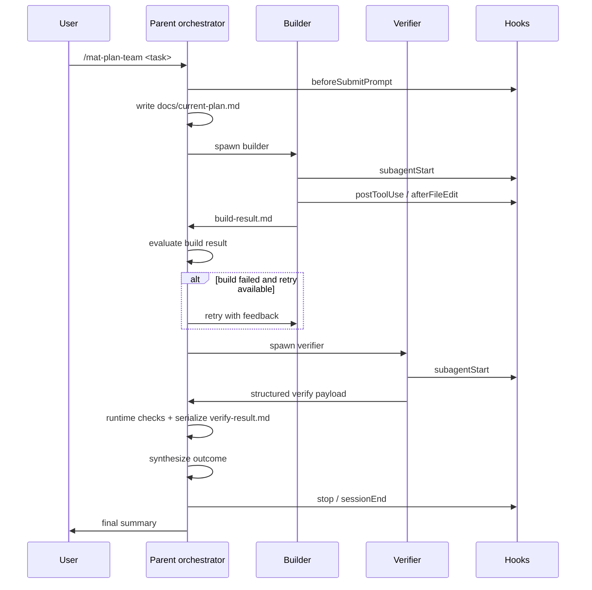

# Orchestration Workflow

- Purpose: Describe the sequencing, retries, result synthesis, and subagent lifecycle used by the parent orchestrator.
- Audience: Maintainers and operators debugging or extending the orchestration layer.
- Prerequisites: Familiarity with `.cursor/commands/mat-plan-team.md`, `.cursor/agents/parent-orchestrator.md`, and the builder/verifier handoff files.
- Status: complete
- Last updated: 2026-06-25 (PostToolUse path extraction + SubagentStart root parity)
- Author: Cursor agent (GPT-5.4)

## Cursor To-dos (MAO — Phase 2 MVP)

Alongside files, the parent orchestrator may keep a **three-task** Cursor To-do list (`[mao:plan]`, `[mao:build]`, `[mao:validate]`) per [`todo-orchestration.md`](todo-orchestration-protocol.md). Status order enforces **build complete before validate starts**. Files remain the source of truth for acceptance. If todos are skipped, behavior matches the historical file-only sequence.

After file-writing updates to `docs/current-plan.md` or `build-result.md` (detected via expanded [`get_changed_files()`](../../.cursor/hooks/post_tool_validate.py) path extraction on `PostToolUse`), hooks may write [`artifacts/mao/gate.json`](../../artifacts/mao/README.md) (`build_may_start`, stricter `validate_may_start`, `advisory_pending`, and **`mao_worktree`** for the active workspace root) and overwrite gitignored **`artifacts/mao/downstream-readiness.json`** with deterministic per-edge **`unblock_semantic`** (and optional todo observation cross-check). Opt-in **`CURSOR_MAO_HOOK_AUTO_TRANSITION_CAPTURE`** may append **`transition-events.jsonl`** via the same `capture_transition_decision()` semantics after gate refresh; opt-in **`CURSOR_MAO_VERIFIER_AUTOSTART`** may write **`verifier-autostart-intent.json`** after a successful build→validate hook capture (parent still spawns the verifier). When `CURSOR_MAO_GATE=0`, handoff writes still refresh **`downstream-readiness.json`** from live file evaluation. The parent may call **`evaluate_parent_downstream_readiness_advisory()`** in [`mao_gate.py`](../../.cursor/hooks/mao_gate.py) (or [`scripts/mao-downstream-readiness.py`](../../scripts/mao-downstream-readiness.py), including `--interpret-edges`) to compare that snapshot to live edge semantics (`trusted_snapshot_for_hint` only when aligned), or use **`evaluate_mao_parent_transition_bundle()`** for one edge’s decision + mutations + semantic interpretation in one return value. The orchestrator still confirms handoffs and mtimes before moving build or validate forward. `advisory_pending` can label still-`pending` downstream work as `blocked` or `ready_for_parent_review`, but only the parent may convert the real todo to `in_progress`. `evaluate_plan_to_build_transition()` / `evaluate_build_to_validate_transition()` attach an explicit `advisory_pending` bundle (live recompute vs optional on-disk snapshot, `aligned_with_live`, and deterministic `interpretation`) so the parent can consume pending-state metadata without treating the gate file as sole truth. When those explicit checks happen, the parent appends a durable review record to gitignored `artifacts/mao/transition-events.jsonl` via `capture_transition_decision()` in [`mao_gate.py`](../../.cursor/hooks/mao_gate.py), which **embeds** the same `todo_mutations` map as `parent_owned_todo_mutations_for_transition()` on each line, overwrites gitignored `suggested-todo-mutation.json` when the append succeeds, and refreshes **`downstream-readiness.json`** with `trigger: transition_capture` (or `hook_post_tool_use_auto_capture` when the append came from opt-in PostToolUse capture) — still **no** hook-driven `TodoWrite`. The parent composer then applies supported deltas with `validate_mao_todo_mutations_against_todos()` + `apply_parent_todo_mutations_to_cursor_todos()` (or stdin JSON through [`scripts/mao-todo-write-merge.py`](../../scripts/mao-todo-write-merge.py)) before calling `TodoWrite merge`. Optional backend emission of that same decision is fail-open.

On **`PostToolUse`** for normalized **`todo_write`**, [`post_tool_validate.py`](../../.cursor/hooks/post_tool_validate.py) may append **`artifacts/mao/todo-write-events.jsonl`** and overwrite **`artifacts/mao/last-todo-write-observation.json`** via `record_mao_todo_write_post_tool_observation()` for audit (`parse_quality`, MAO rows, `file_handoff_signals`), then refresh **`downstream-readiness.json`**. This does **not** replace parent transition checks or spawn subagents (`CURSOR_MAO_TODO_POST_TOOL_USE=0` disables observation; `CURSOR_MAO_DOWNSTREAM_READINESS=0` disables the readiness file).

## Related Files

- [Agent instructions](../../AGENTS.md)
- [Todo orchestration](todo-orchestration-protocol.md)
- [Parent design notes](../archive/orchestration.md)
- [Data flow](data-flow.md)
- [Agent teams](agent-teams.md)
- [Components](components.md)
- [Pilot report](../archive/pilot-report.md)
- [Artifacts index](artifacts-index.md)
- [Decision record — P2 nested/background subagents](decision-record.md#p2-audit--nested-and-background-subagents)
- [Decision record — P2 worktree wrapper strategy](decision-record.md#p2-audit--worktree-wrapper-strategy)

## Sequence Overview



ASCII fallback:

```text
User -> Parent -> current-plan
Parent -> Builder -> build-result
Parent -> Verifier -> structured verify payload
Parent -> serialize verify-result.md -> summary -> User
Hooks observe each major transition
```

## Step-By-Step Lifecycle

1. User runs `/mat-plan-team <task>`.
2. Parent writes `docs/current-plan.md` with acceptance criteria and handoff expectations. Substantive execution plans include append-only **`## Amendments`** (ISO-8601 UTC lines; parent may append during orchestration) and contract **status marker checklists** (`[]`, `[wip]`, `[x]`, `[f]` — advisory on the plan; gates on handoff files) per [`plan-contract.md`](plan-contract.md).
3. Parent performs the explicit `plan -> build` transition check, optionally using a fresh positive MAO gate as advisory support, optionally reading **`evaluate_parent_downstream_readiness_advisory()`** or **`evaluate_mao_parent_transition_bundle()`** for trusted vs live readiness hints and `unblock_semantic` interpretation, reads `decision["advisory_pending"]` for live vs file pending semantics, records that decision with `capture_transition_decision()` (surfacing **`todo_mutations`** on the result and JSONL line; successful append also refreshes **`downstream-readiness.json`**), validates/applies those tag-prefix mutations onto the live todo list, and issues `TodoWrite merge` only when `todo_mutations` is non-empty and validation passes.
4. Parent spawns the builder.
5. Builder edits files, triggers hooks, and writes `build-result.md`.
6. Parent reads `build-result.md`, performs the explicit `build -> validate` transition check, optionally uses **`evaluate_parent_downstream_readiness_advisory()`** or **`evaluate_mao_parent_transition_bundle(..., "build_to_validate")`** again for validate-edge hints, reads `decision["advisory_pending"]` for validate-focused pending semantics, records that decision with `capture_transition_decision()` (surfacing **`todo_mutations`**; successful append refreshes **`downstream-readiness.json`**), validates/applies those mutations onto the live todo list, and issues `TodoWrite merge` only when `todo_mutations` is non-empty and validation passes.
7. If builder status is `FAIL`, parent retries up to the configured limit.
8. Parent spawns the verifier.
9. Verifier reads the plan and build result, inspects changed files read-only, and returns a **structured verify payload** (no `verify-result.md` write — `readonly: true`).
10. Parent runs plan global validation commands and D2c scope gate when applicable, serializes `verify-result.md` from the payload, then reads the on-disk handoff.
11. Parent writes a synthesis summary and answers the user.

## Retry Logic

The current orchestration strategy is deliberately simple:

- Builder retries: up to 2 attempts.
- Verifier retries: effectively 1 re-run after a builder fix.
- Hook loops: controlled separately by `loop_limit` in `../.cursor/hooks.json`.

Recommended escalation path:

1. Retry builder if the problem is clearly fixable.
2. Stop and report if the same failure repeats.
3. Do not loop indefinitely waiting for a perfect verifier result.

## Result Synthesis

The parent synthesizes from three sources:

- `docs/current-plan.md`
- `build-result.md`
- `verify-result.md`

The final answer should communicate:

- What was attempted
- What actually changed
- Which acceptance criteria passed or failed
- Whether follow-up work is needed

## Execution closeout contract

Use this contract for `/mat-plan-team`, `/mat-long-run`, `/mat-plan-onboarding` follow-up execution handoffs, `/mat-build`, `/mat-review`, and similar execution sessions.

1. Refresh the relevant docs or summary artifacts after the last meaningful doc or artifact change, especially `README.md`, `AGENTS.md`, `CHANGELOG.md`, `ROADMAP.md`, and any directly related docs touched by the slice.
2. Re-run the closeout validation commands after that last meaningful change, not before it:
   - `python3 .cursor/scripts/validate_artifacts.py --repo-root . --require-current-plan`
   - `python3 scripts/validate_closeout_coherence.py --repo-root .`
3. Commit the final state once those checks are clean.
4. Push when the handoff is meant to leave the branch shared remotely or the user requested a pushed closeout.
5. Confirm the working tree is clean with `git status --short` before claiming the execution closeout is complete.

Do not treat an earlier validation pass or a still-dirty tree as a substitute for this contract. If push is not requested, say that explicitly instead of implying it happened.

## Subagent Lifecycle

`subagentStart` and `subagentStop` matter for these reasons:

1. They tell you when delegation actually occurred.
2. They provide audit data for timing, sequencing, and dashboard views.
3. `subagentStart` payloads include resolved **`mao_worktree`** (and optional parent `mao_worktree.label` inside parsed `mao_task_context`) so parallel builder/verifier worktrees are traceable in `logs/<session_id>/subagent_start.json`.

Recommended interpretation:

- `subagentStart` without a matching `subagentStop` suggests an interrupted or hanging run.
- Multiple `subagentStart` events for the same role often indicate a retry.
- `subagentStop` followed by `stop` and `sessionEnd` marks a complete turn lifecycle.

## Nested and background subagents (boundaries)

MAT allows **selective** use of Cursor foreground/background subagents and child spawning where they do not weaken file-first honesty. Full strategy and non-goals: [`decision-record.md`](decision-record.md) — P2 Audit — Nested and Background Subagents.

**Allowed patterns**

- Parent-owned `/mat-plan-team` sequencing: builder → explicit file check → verifier.
- Parallel read-only fanout via `/mat-subagents-spawn` or explore-style Task delegation.
- **Resume same subagent** before supersede when progress is unclear ([`AGENTS.md`](../../AGENTS.md) wait-before-supersede).
- Builder or verifier in a **separate worktree** when the operator explicitly created isolation (see [`decision-record.md`](decision-record.md) — worktree wrapper strategy).

**Explicit non-goals (orchestration)**

- No subagent spawn from **live Cursor todo state** or dashboard todo column claims.
- No **hook auto-delegation** — `gate.json`, `downstream-readiness.json`, and `verifier-autostart-intent.json` are **advisory** only; the parent still runs explicit handoff checks and owns spawn.
- No replacement for `capture_transition_decision()` or parent-owned `TodoWrite` on MAO transitions.
- Hooks do **not** ship hook-driven subagent auto-spawn; parent orchestrator remains the spawn authority.

Canonical truth stays **file handoffs** plus parent-owned checks; MAO todos and hook-derived observations stay **advisory** alongside those files.

## Run manifest (N4, advisory)

Optional **`artifacts/mat-runs/<run-id>/manifest.json`** indexes plan/build/verify content hashes and advisory trace IDs. It is **derived only** from handoff files via `scripts/mat_run_manifest.py` — never a gate authority.

| Operator action | Command |
|-----------------|---------|
| Parent closeout write (opt-in) | Set `CURSOR_MAT_RUN_MANIFEST=1`, then `python3 scripts/mat_run_manifest.py closeout-write --mission-slug … --slice-id …` after verify PASS (see parent-orchestrator Step 5b) |
| List + stale check | `bash scripts/doctor.sh --run-manifest` |
| Single-run check | `python3 scripts/mat_run_manifest.py check --run-id <run_id>` |

Stale hash mismatch is a **visible advisory warning** (`gate_impact: none`). It must **not** fail verify or override `build-result.md` / `verify-result.md` gates. When the parent requests manifest correlation, builder/verifier should include `trace_run_id` in `## Trace Correlation` when known. Spec: [`specs/mat-run-manifest-v1.md`](../../specs/mat-run-manifest-v1.md).

## Example Run

```text
/mat-plan-team Create ROADMAP.md and verify it contains future improvements
```

Expected path:

1. Parent writes `docs/current-plan.md`.
2. Builder creates or edits `ROADMAP.md` and writes `build-result.md`.
3. Verifier checks `ROADMAP.md` read-only and returns a structured payload; parent serializes `verify-result.md`.
4. Hook logs appear in `logs/<session_id>/`.

## Failure Modes

| Failure | Likely cause | Response |
|---------|--------------|----------|
| `build-result.md` missing | Builder did not complete or wrote to wrong path | Stop and inspect builder output |
| `verify-result.md` missing after verifier stop | Parent did not serialize handoff (or verifier never returned payload) | Confirm structured payload; parent runs `serialize_verify_result()`, then re-run verifier once if needed |
| Repeated hook failures | Broken validator or environment issue | Fix config or disable the failing hook temporarily |
| Observability missing | Server not running or POST failed | Use file logs first, then restore HTTP event path |

## Acceptance Checklist

- [ ] This sequence matches `.cursor/commands/mat-plan-team.md` and `.cursor/agents/parent-orchestrator.md`.
- [ ] Retry behavior is documented separately from hook `loop_limit`.
- [ ] `subagentStart` and `subagentStop` are described as lifecycle signals, not abstract theory.
- [ ] A reviewer can follow the example run and know which files to inspect.
